# SPACECARE

> **Intelligent Astronaut Health Monitoring & Early Warning System**  
> *NASA Space Apps Challenge 2026*

---

## 1. Project Overview & Problem Statement

Human spaceflight missions extending beyond Low Earth Orbit (such as the Artemis lunar campaigns and planned Mars expeditions) place astronauts under sustained multi-system physiological and psychological stressors. Microgravity induces rapid bone demineralization and cardiovascular deconditioning; cosmic and solar radiation present acute and long-term carcinogenic and neurological risks; and extreme confinement coupled with isolation induces sleep fragmentation and cognitive strain.

Compounding these hazards, deep space transit involves communication latencies of up to 22 minutes each way, precluding real-time telemedicine from mission control on Earth. 

**SPACECARE** is an autonomous, intelligent health monitoring and early warning software platform designed for deep space missions. It synthesizes physiological signals, environmental space radiation hazards, and sleep/wellbeing indicators to detect anomalous health patterns early and deliver evidence-based clinical mitigation recommendations directly to crew members and medical officers.

---

## 2. Project Objectives

- **Continuous Health Telemetry Tracking**: Aggregate multi-domain physiological telemetry (cardiovascular, respiratory, musculoskeletal indices).
- **Environmental Hazard Awareness**: Monitor cabin dosimeter readings and correlate with solar particle events via NASA DONKI.
- **Intelligent Anomaly Detection**: Implement unsupervised machine learning and clinical thresholding to detect early signs of physiological degradation before acute incidents occur.
- **Evidence-Based Mitigation**: Deliver actionable, scientifically grounded countermeasures aligned with NASA Human Research Program protocols.
- **Mission Health Reporting**: Generate comprehensive, individualized health status summaries for each crew member.

---

## 3. Implemented Capabilities & Features

- [x] **Real-Time Astronaut Telemetry Dashboard**: High-visibility mission control view tracking vital signs, SpO2, core body temperature, and HRV with connection state detection (`LIVE_API`, `API_HEALTHY_ROUTES_PENDING`, `OFFLINE_DEMO_FALLBACK`).
- [x] **Cardiovascular Adaptation Monitor**: Longitudinal tracking of orthostatic intolerance risk and arterial stiffness indices calibrated against aerospace clinical references.
- [x] **Musculoskeletal Loss Tracker**: Tracking exercise countermeasure adherence (ARED, T2, CEVIS) against bone mineral density loss curves, with direct integration to NASA OSDR bed-rest analogues.
- [x] **Space Radiation & Live NASA DONKI CME Survelliance**: Cabin dosimeter tracking correlated with live NASA CCMC DONKI Coronal Mass Ejections and Solar Particle Events (`/api/v1/radiation/cme`).
- [x] **NASA Open Science Data Repository (OSDR) Quality Control**: Complete research-grade browser for study OSD-946 / GLDS-773 (70-day bed rest miRNA microarray quality-control dataset) with cohort and sample probe statistics.
- [x] **NASA-STD-3001 Operational Hazard & Physiology Lab**: Interactive multi-hazard spaceflight stressor simulator (Radiation flux, cabin O2/CO2, G-transitions, fluid shifts) with real-time biometric coupling.
- [x] **Clinical Manual Health Input Workstation**: Astronaut vital signs submission portal conforming 1-to-1 with backend SQLAlchemy schema and Pydantic validation.
- [x] **Sleep Architecture & Psychological Wellbeing**: Circadian rhythm tracking, actigraphy sleep log entries, and physiological coupling.
- [x] **AI-Powered Anomaly Detection Engine**: Unsupervised multivariate anomaly detection utilizing Scikit-learn's Isolation Forest and deterministic multi-hazard heuristics (`/api/v1/telemetry`).
- [x] **Early Warnings & Clinical Alert Dispatcher**: Multi-tiered priority alert queue with clinical countermeasure dispatch and acknowledgment workflows.
- [x] **Individual Astronaut Health Profiles & Medical Dossier**: Exportable mission medical status reports with longitudinal Recharts visualization.

---

## Application Screenshots & Feature Walkthrough

### Live End-to-End Demo Walkthrough (< 30s)

🎥 **Video Demonstration**: [Watch / Download SPACECARE Live Demo Walkthrough (1440x900, WebM)](docs/demo/SPACECARE_live_demo.webm)

A rapid, full-coverage operational walkthrough of the running SPACECARE system in under 30 seconds:
- **0:00 – 0:05:** Animated NASA Mission Briefing overlay, Earth–Mars latency comparison, and HUD console launch.
- **0:05 – 0:21:** Live `LIVE_API` Mission Overview, all 6 clinical telemetry domains (Crew, Vitals, Cardiovascular, Bone/Muscle BMD, NASA DONKI Radiation, Circadian Sleep), Isolation Forest AI diagnostics, and Multi-Hazard Stress Simulator.
- **0:21 – 0:28:** Live SQLite biometric entry (`Manual Health Input`), Alert Triage, Flight Surgeon Reports, and NASA OSDR-946 Research Analog QC.

---

Explore the comprehensive visual command suite and aerospace clinical interfaces implemented in SPACECARE:

### 1. Mission Briefing Overlay — Orbital Hero & Telemetry Intro
The high-impact 60fps landing sequence featuring an interactive mathematical gyroscopic astrolabe, real-time audio/HUD reticle locks, and live telemetry pre-warming. It introduces flight surgeons and mission specialists to the autonomous health management paradigm before transitioning into active monitoring.

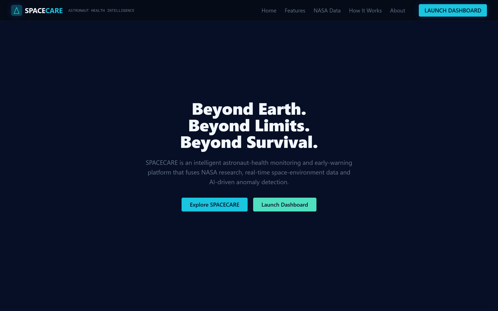

---

### 2. Mission Briefing — Earth–Mars Latency & Primary Mission Objectives
Interactive aerospace briefing contrasting the communication latency of deep-space transit (up to 24 minutes one-way delay) against on-board local AI triage (< 12ms inference). It outlines the core architectural pillars: proactive anomaly detection, multi-hazard simulation, and automated clinical countermeasures.

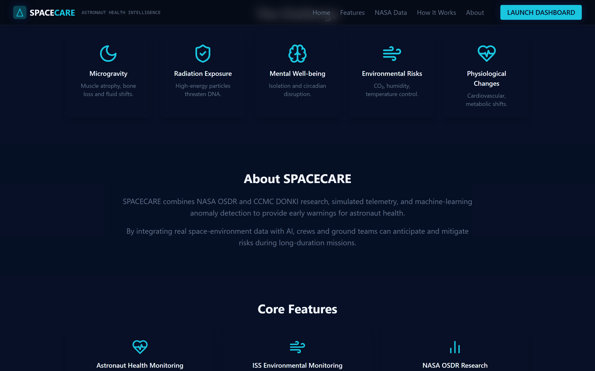

---

### 3. Mission Overview Dashboard
The unified flight control overview featuring live mission elapsed time, real-time UTC clock synchronization, active FastAPI backend connection beacons, vital sign KPI cards, and longitudinal 24-hour physiological trend graphs.

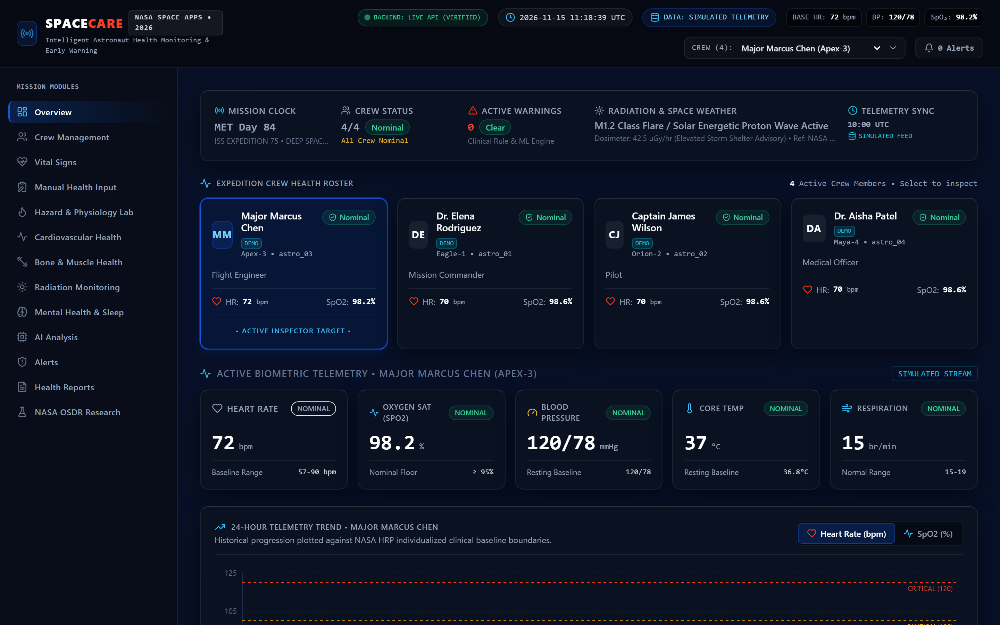

---

### 4. Crew Medical Management Console
Comprehensive crew medical dossier tracking active astronaut profiles, flight roles, and personalized resting baselines seeded dynamically from SQLite. Enables flight surgeons to review medical histories and inspect individual vital bounds.

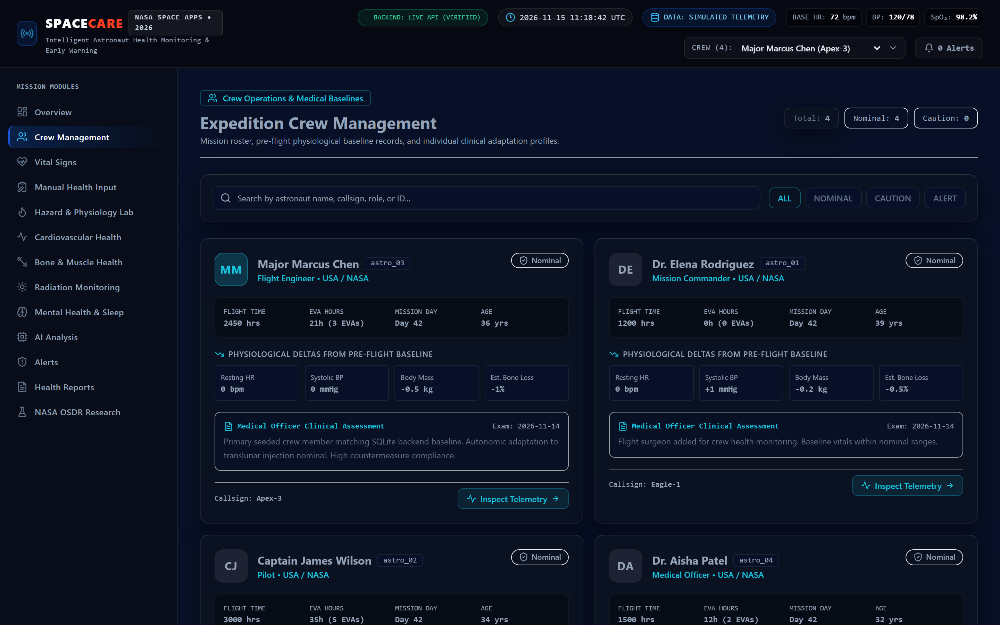

---

### 5. Continuous Vital Signs Monitor
Multi-channel physiological telemetry stream visualizing Heart Rate, Blood Pressure, SpO₂, Core Temperature, and Respiration Rate against strict NASA-STD-3001 clinical safety limits and customizable simulation streams.

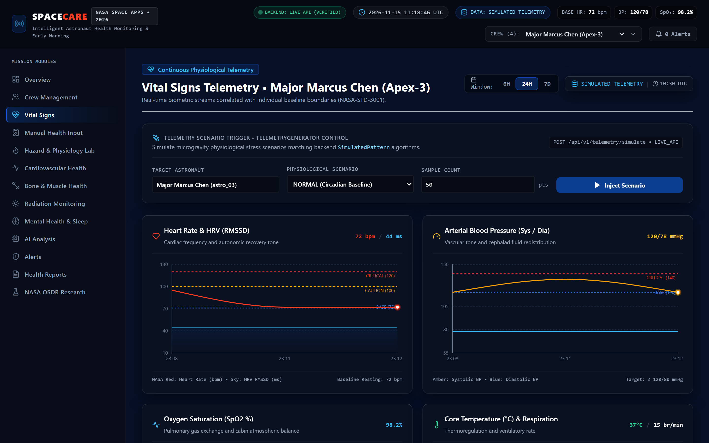

---

### 6. Cardiovascular & Hemodynamic Tracker
Longitudinal assessment of cardiovascular deconditioning, cephalad fluid shift risks, resting heart rate elevations, and orthostatic intolerance probabilities during long-duration microgravity exposure.

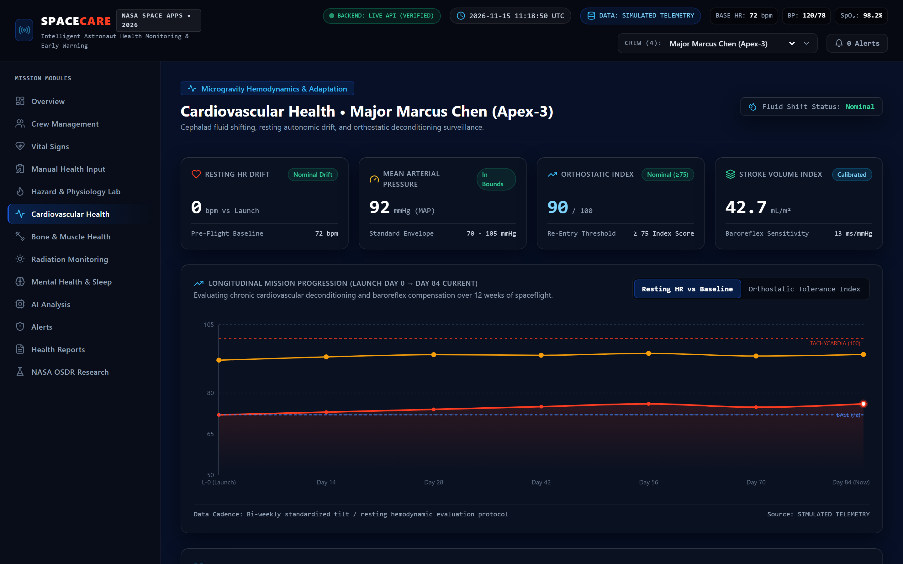

---

### 7. Musculoskeletal & Bone Loss Monitor
Tracks monthly bone mineral density (BMD) demineralization rates across lumbar spine and femoral neck alongside daily countermeasure exercise adherence (ARED resistive and T2 treadmill protocols).

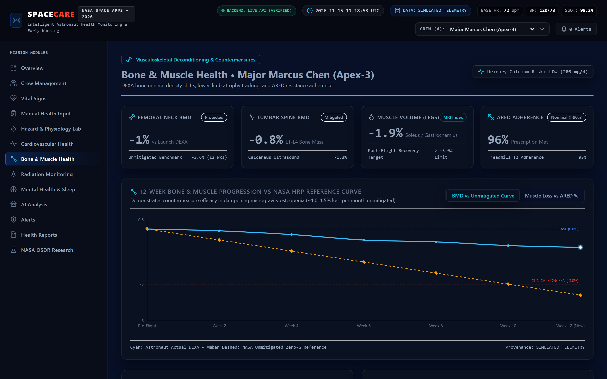

---

### 8. Deep Space Radiation & Live NASA CCMC DONKI CMEs
Surveillance dashboard tracking cumulative astronaut ionizing radiation dose in millisieverts (mSv) against NASA Career Radiation Limits, integrated with live Coronal Mass Ejection (CME) alerts directly from NASA CCMC DONKI.

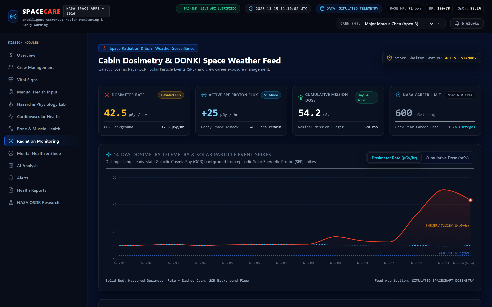

---

### 9. Mental Health, Circadian & Sleep Architecture
Monitors 7-day actigraphy sleep cycles (REM, Deep, Light, Wake), circadian phase shifting, subjective mood tracking, and NASA Task Load Index (TLX) cognitive fatigue scores for astronaut psychological readiness.

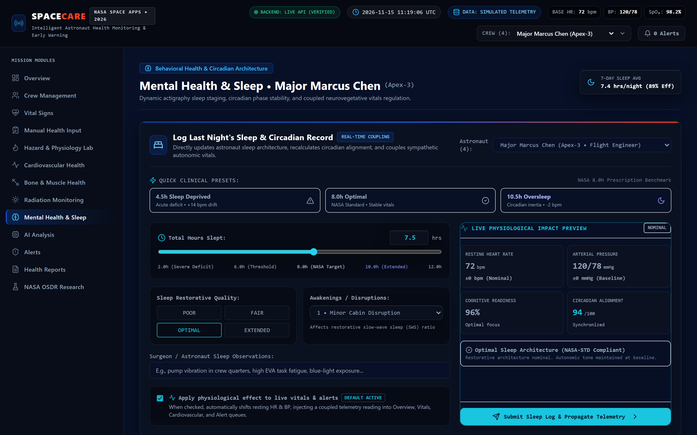

---

### 10. AI Diagnostics & Isolation Forest Attribution
Autonomous clinical diagnostic interface driven by Member 3's unsupervised Isolation Forest model, surfacing multivariate anomaly confidence scores, feature attribution radars, and evidence-based clinical countermeasures.

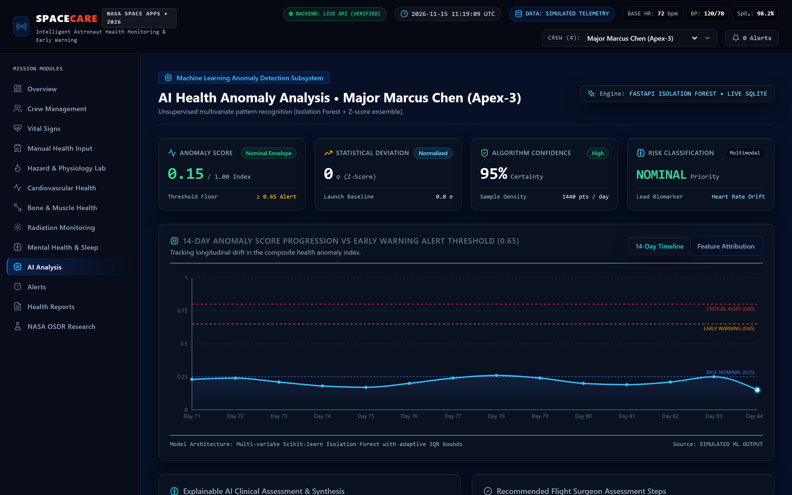

---

### 11. Active Warning & Hazard Triage Console
Prioritized multi-tier clinical alert queue (`CRITICAL`, `WARNING`, `NOMINAL`) equipped with one-click flight-surgeon acknowledgment, resolution workflows, and chronological triage event logging persisted to SQLite.

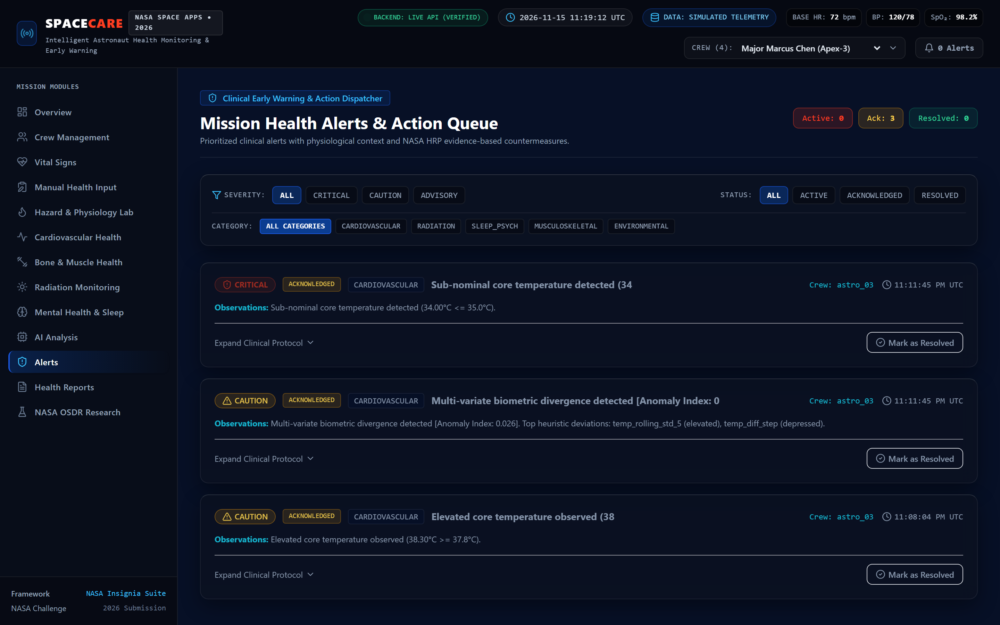

---

### 12. Mission Flight Surgeon Health Reports
Automated clinical dossier generator aggregating individualized astronaut baselines, cumulative environmental exposures, and longitudinal vital summaries for comprehensive flight surgeon debriefs.

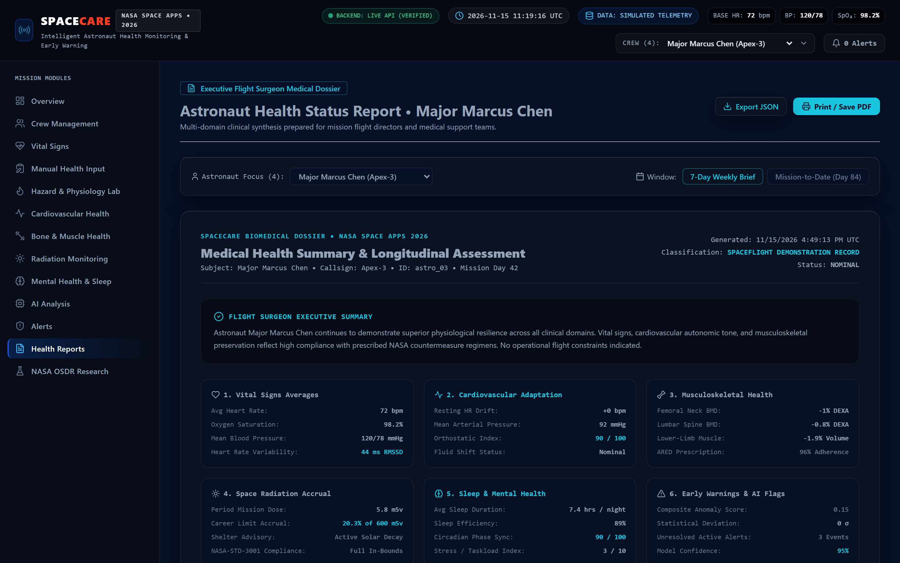

---

### 13. Interactive Multi-Hazard Stress Simulator
High-fidelity spaceflight stressor sandbox allowing medical officers to simulate acute Solar Particle Events (SPE), cabin depressurization, severe hypercapnia/hypoxia, and physical deconditioning with real-time biometric trajectory projections.

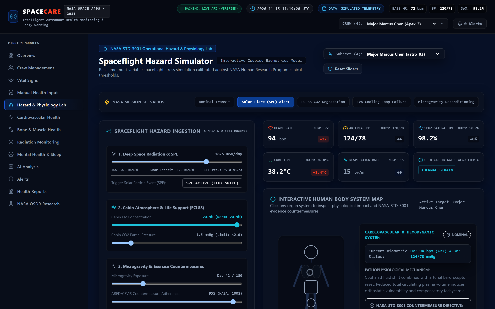

---

### 14. Manual Biometric & Health Input Console
Validated clinical input portal allowing crew members to record manual vital measurements, subjective symptoms, and sleep diary entries with real-time range validation conforming 1-to-1 with backend schemas.

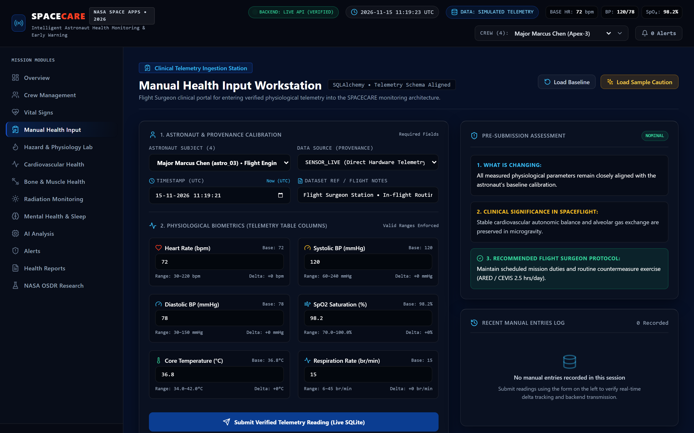

---

### 15. NASA OSDR-946 Microgravity Research Analog QC
Direct analytical integration with NASA Open Science Data Repository study OSD-946 / GLDS-773, analyzing 44 bed-rest analog samples to evaluate micro-RNA biological adaptations in microgravity with distribution charts and quality-control matrices.

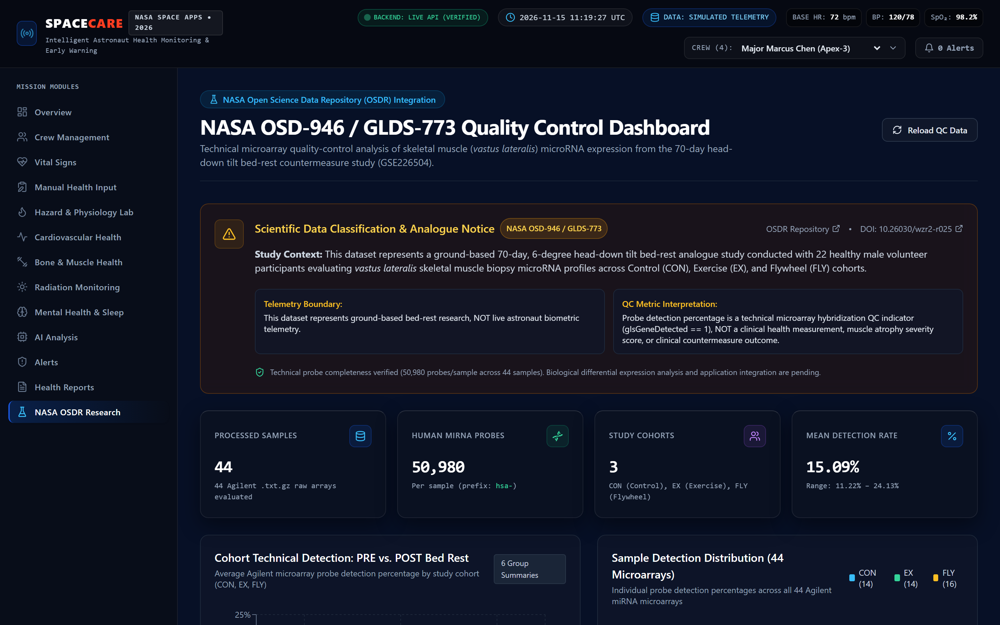

---

## 4. Technology Stack

### Frontend
- **Framework**: React 18+
- **Build Tool**: Vite
- **Language**: TypeScript
- **Styling**: Tailwind CSS
- **Visualization**: Recharts
- **Icons**: Lucide React

### Backend
- **Framework**: FastAPI (Python 3.10+)
- **Validation**: Pydantic v2
- **ORM / Database**: SQLAlchemy 2.0 (SQLite for development, PostgreSQL-ready)
- **HTTP Client**: HTTPX (Async NASA API queries)

### Machine Learning & Data Processing
- **Scientific Computing**: NumPy, Pandas
- **Anomaly Detection**: Scikit-learn (Isolation Forest, Outlier Detection, Robust Scalers)

### NASA Data Integration
- **NASA Open Science Data Repository (OSDR)**: Baseline physiological distributions
- **NASA Life Sciences Data Archive (LSDA)**: Microgravity adaptation records
- **NASA Human Research Program (HRP)**: Evidence-based countermeasure guidelines
- **NASA DONKI API**: Solar energetic particle events, coronal mass ejections, and solar flare telemetry

---

## 5. Project Structure

```
SPACECARE/
│
├── frontend/                     # React + Vite + TypeScript application
│   ├── public/
│   │   ├── images/               # Static images and branding
│   │   └── icons/                # Spacecraft & medical UI icons
│   ├── src/
│   │   ├── assets/               # Local styles and assets
│   │   ├── components/           # Modular UI components
│   │   │   ├── common/           # Shared UI primitives (buttons, modals, badges)
│   │   │   ├── dashboard/        # Mission overview & status cards
│   │   │   ├── health/           # Cardiovascular, vitals, musculoskeletal widgets
│   │   │   ├── radiation/        # Dosimeter and space weather components
│   │   │   ├── mental-health/    # Sleep and psychological wellbeing cards
│   │   │   └── alerts/           # Early warning notifications & actions
│   │   ├── pages/                # Top-level view routes
│   │   ├── layouts/              # Navigation and shell layout wrappers
│   │   ├── hooks/                # Custom React state & telemetry hooks
│   │   ├── services/             # Typed API clients for backend endpoints
│   │   ├── types/                # TypeScript interface definitions
│   │   ├── utils/                # Formatting and statistical helpers
│   │   ├── styles/               # Global CSS & Tailwind setup
│   │   ├── App.tsx               # Root application component
│   │   └── main.tsx              # React DOM entry point
│   ├── index.html                # Vite HTML shell
│   ├── package.json              # Frontend dependencies and npm scripts
│   ├── tsconfig.json             # TypeScript compiler configuration
│   └── vite.config.ts            # Vite bundler configuration
│
├── backend/                      # Python / FastAPI application
│   ├── app/
│   │   ├── api/                  # API routers & endpoint controllers
│   │   │   └── routes/           # Domain routes (health, alerts, astronauts)
│   │   ├── core/                 # App configuration & security settings
│   │   ├── models/               # SQLAlchemy ORM database models
│   │   ├── schemas/              # Pydantic request/response schemas
│   │   ├── services/             # Core business logic services
│   │   ├── database/             # Database engine & session management
│   │   ├── integrations/         # External service connectors
│   │   │   └── nasa/             # NASA OSDR & DONKI API clients
│   │   ├── ml/                   # Machine learning subsystem
│   │   │   ├── models/           # Trained models & serialization
│   │   │   ├── preprocessing/    # Feature pipelines & scalers
│   │   │   └── anomaly_detection/# Anomaly detection algorithms
│   │   ├── alerts/               # Alert generation & rule engine
│   │   └── main.py               # FastAPI application entry point
│   ├── tests/                    # Unit and integration test suite
│   └── requirements.txt          # Python dependencies
│
├── data/                         # Project data stores
│   ├── raw/
│   │   ├── nasa/                 # Real research data from NASA archives
│   │   └── simulated/            # Synthesized telemetry for testing
│   ├── processed/                # Normalized datasets ready for ML
│   ├── sample/                   # Test fixtures and mock payloads
│   └── README.md                 # Data classification & provenance guide
│
├── research/                     # Scientific background & literature
│   ├── nasa_sources.md           # Official NASA portals & API endpoints
│   ├── datasets.md               # Dataset catalog and schemas
│   ├── scientific_references.md  # Academic citations & medical standards
│   └── methodology.md            # Research methodology & validation criteria
│
├── docs/                         # Engineering documentation
│   ├── architecture.md           # System architecture & component diagram
│   ├── api_documentation.md      # REST API contracts & endpoint specifications
│   ├── setup_guide.md            # Developer onboarding & environment setup
│   └── team_contributions.md     # Team roles, responsibilities & ownership
│
├── scripts/                      # Utility scripts (telemetry generators, seeders)
├── .gitignore                    # Git exclusions
├── .env.example                  # Environment configuration template
├── README.md                     # Project overview and guide (this file)
└── LICENSE                       # MIT Open Source License
```

---

## 6. Team Responsibilities

- **Member 1 – Team Lead**: NASA research, dataset identification, scientific validation, NASA data integration, GitHub coordination, and final system integration.
- **Member 2 – Frontend Developer**: React application, dashboard UI, health monitoring interfaces, charts & visualizations, and frontend API integration.
- **Member 3 – Backend & ML Developer**: FastAPI backend, database modeling, data processing pipelines, ML anomaly detection, alert generation, and backend API development.

Detailed task assignments and workflow guidelines are documented in [docs/team_contributions.md](docs/team_contributions.md).

---

## 7. Setup Instructions

### Completed Project Scaffolding
- [x] Directory structure initialized and organized.
- [x] Configuration manifests (`package.json`, `tsconfig.json`, `requirements.txt`) configured.
- [x] Architecture and API specifications defined.
- [x] Environment variable template `.env.example` created.

### Step-by-Step Setup

1. **Clone & Configure Environment**:
   ```bash
   cp .env.example .env
   ```
   *(Update `.env` with your NASA API key if available)*

2. **Backend Setup**:
   ```bash
   cd backend
   python -m venv venv
   # Activate: source venv/bin/activate (Linux/Mac) or .\venv\Scripts\Activate.ps1 (Windows)
   pip install -r requirements.txt
   uvicorn app.main:app --reload
   ```
   *(Backend runs on `http://127.0.0.1:8000`, docs at `http://127.0.0.1:8000/docs`)*

3. **Frontend Setup**:
   ```bash
   cd frontend
   npm install
   npm run dev
   ```
   *(Frontend runs on `http://localhost:5173`)*

### Testing & Verification

1. **Backend Test Suite (84 Automated Tests)**:
   ```bash
   cd backend
   pytest
   ```
   *Covers database initialization, astronaut CRUD, telemetry ingestion bounds validation, alert creation/deduplication/acknowledgment, Isolation Forest scoring, multi-hazard preprocessing, NASA OSD-946 quality control endpoints, and NASA DONKI CME integration.*

2. **Frontend Production Build**:
   ```bash
   cd frontend
   npm run build
   ```
   *Strict TypeScript checks (`tsc`) and Vite asset bundling with zero compiler errors.*

---

## 8. Scientific Disclosures & Ethical Compliance

- **Non-Diagnostic Disclaimer**: SPACECARE is an aerospace decision-support prototype built for the NASA Space Apps Challenge 2026. It is not certified medical device software and does not diagnose, treat, or prevent clinical diseases.
- **NASA Data Attribution**: 
  - Coronal Mass Ejection event data is retrieved via NASA CCMC DONKI (`https://ccmc.gsfc.nasa.gov/DONKI-API/get/CME`).
  - Microarray quality control data is derived from NASA Open Science Data Repository study OSD-946 / GLDS-773 (70-day bed rest study, GSE226504).
  - Individual astronaut vitals and real-time streaming telemetry in this software are algorithmically generated synthetic demonstrations calibrated against NASA-STD-3001 and the NASA Human Research Program Evidence Books, not real astronaut medical records.
